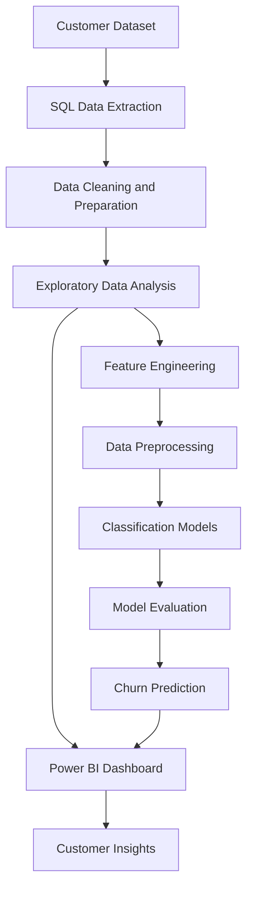

# Customer Churn Prediction

An end-to-end machine learning project focused on analyzing customer data and predicting customer churn using **SQL, Python, and Machine Learning**, with Power BI for data visualization and insights.

## Project Overview

Customer churn occurs when customers stop using a company's products or services. Identifying customers who are more likely to leave can help businesses understand customer behavior, investigate potential causes of attrition, and make informed retention decisions.

This project explores customer data, performs data preparation and exploratory analysis, and applies machine learning classification techniques to predict customer churn.

The workflow combines SQL-based data extraction, Python-based analysis and modelling, and Power BI visualization.

## Objectives

- Analyze customer data to understand patterns associated with churn.
- Use SQL to extract, query, and prepare data for analysis.
- Perform Exploratory Data Analysis (EDA) to identify relevant trends and relationships.
- Apply feature engineering and preprocessing techniques to prepare data for modelling.
- Develop and evaluate classification models for churn prediction.
- Present relevant findings through Power BI visualizations.

## Project Workflow

## Tools and Technologies

| Category | Technologies |
|---|---|
| Programming | Python |
| Database | SQL |
| Data Analysis | Pandas, NumPy |
| Visualization | Matplotlib, Seaborn, Power BI |
| Machine Learning | Scikit-learn |
| Core Techniques | EDA, Feature Engineering, Classification, Model Evaluation |

*The technology list should be adjusted to match the libraries and algorithms actually used in the project.*

## Methodology

### 1. Data Extraction and Preparation
- Used SQL queries to retrieve and organize customer information.
- Prepared the dataset for subsequent analysis and modelling.
- Examined data quality and handled preprocessing requirements.

### 2. Exploratory Data Analysis
- Analyzed customer attributes and their relationship with churn.
- Examined distributions and patterns across relevant variables.
- Used visualizations to understand customer characteristics and identify potential churn-related trends.

### 3. Feature Engineering and Preprocessing
- Prepared relevant features for machine learning.
- Applied suitable transformations to numerical and categorical variables.
- Organized the data for classification modelling.

### 4. Machine Learning
- Developed classification models to predict customer churn.
- Evaluated model performance using appropriate classification metrics.
- Compared model results to understand predictive performance.

### 5. Power BI Visualization
- Used Power BI to present customer data and analytical findings.
- Developed visualizations to make customer patterns and churn-related insights easier to interpret.

## Key Learnings

- Practical application of SQL for data extraction and analysis.
- Understanding the end-to-end machine learning workflow.
- Applying EDA and feature engineering to structured datasets.
- Building and evaluating classification models.
- Communicating analytical findings through data visualization.

## Future Enhancements

- Experiment with additional classification algorithms and hyperparameter tuning.
- Improve model evaluation through cross-validation and appropriate classification metrics.
- Incorporate model explainability to understand the factors influencing churn predictions.
- Develop an interactive prediction interface for business users.
